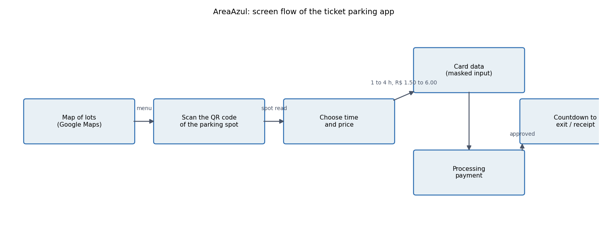
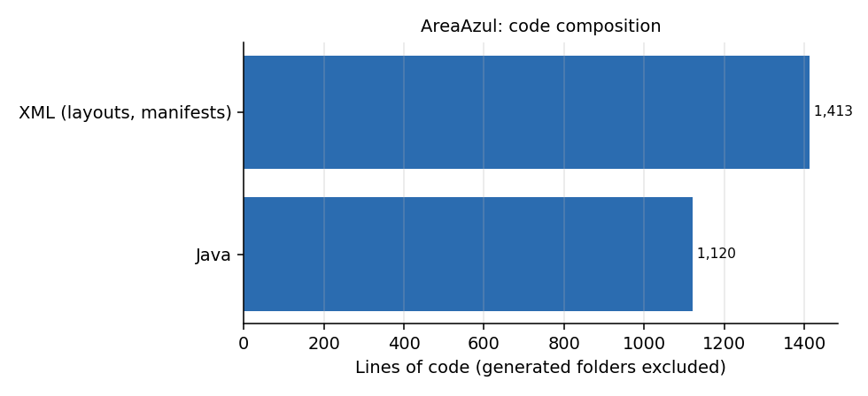

# AreaAzul (Ticket Parking)

**Android app prototype for paying street parking by QR code.** A driver opens the map, scans the QR code printed on the parking spot, picks how long to stay, pays, and gets a countdown to the end of the paid time. Built as a team project (the package is `com.senai.areaazul`; the QR messages use a Goiania street). *Em portugues: aplicativo Android que substitui o talao de estacionamento rotativo (Area Azul) por leitura de QR code, escolha de tempo, pagamento e contagem regressiva.*

## What the app does

| Step | Screen (class) | What happens |
|---|---|---|
| 1 | `MainActivity` + `MapsActivity` | Navigation drawer over a Google Maps fragment of the parking area |
| 2 | `QrCode` | Scans the spot QR code (ZXing). Spots `001`, `002` and `003` are recognised; spot `002` is reserved for elderly drivers and `003` for people with disabilities, with a matching icon and message |
| 3 | `DadosEstacionamento` | Licence plate with an input mask (`MaskUtil`), and a spinner for 1 to 4 hours with a price per option (R$ 1.50, 2.50, 4.50, 6.00) |
| 4 | `DadosCartao` | Card number and expiry with input masks |
| 5 | `ProcessandoPagamento` | Loading animation, simulated approval after 5 s, receipt with share and save icons |
| 6 | `contagemRegressiva`, `aguardandoRetirada` | Countdown timer for the paid time (`ContadorTempo`) and a waiting-for-exit screen |

## What is real and what is a mock

This is a **front-end prototype**. Spot recognition is hard-coded for three spots, the payment is simulated with a delay, and there is no backend, no real card processing and no persistence. What it demonstrates is the complete user journey and the details that make it usable: input masks, a timer that survives screen changes, accessible-spot messaging and a map entry point.

## Build

Android Studio with the Android SDK 28. Open the project, then add your own Google Maps key in `app/src/main/res/values/google_maps_api.xml` (the committed value is a placeholder and the original key was removed from the sources). Libraries: ZXing (QR), Glide (GIFs), Google Maps SDK, `mflibrary` (input masks).

## Notes

- Originally committed with IDE and build folders; they were removed and ignored in 2026. The history still contains an old Maps key that should be considered public and restricted or deleted in the Google Cloud console.
- Older work, kept because it shows a complete product flow.
